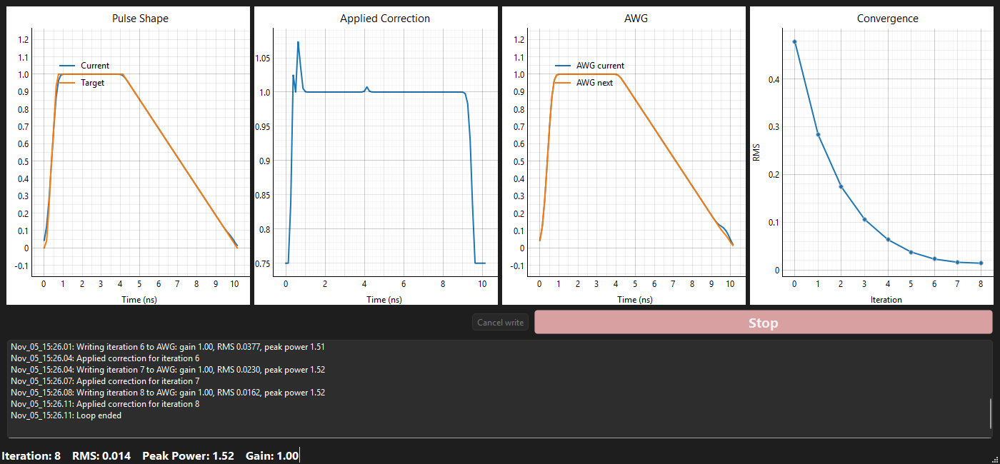

# Beam Profiling: temporal pulse shaping

Shapes the temporal profile of a laser pulse in a closed loop. Each iteration reads
the pulse shape from an oscilloscope over EPICS Channel Access, compares it with a
target shape, and writes a corrected voltage pattern to an arbitrary waveform
generator (AWG).



## Setup

Needs Windows and Python 3.13. Using [uv](https://docs.astral.sh/uv/) (recommended):

```
uv sync
```

This creates `.venv` with the exact versions in `uv.lock`, including the test tools.
Without uv, use pip:

```
python -m venv .venv
.venv\Scripts\pip install -r requirements.txt -r requirements-dev.txt
```

`requirements*.txt` are generated from `uv.lock`; after changing dependencies in
`pyproject.toml`, run `uv lock` and then:

```
uv export --no-hashes --no-dev --no-emit-project -o requirements.txt
uv export --no-hashes --only-group dev --no-emit-project -o requirements-dev.txt
```

## Running

```
uv run beam-shaper
```

or `.venv\Scripts\python main.py`. It can be started from any folder: config, state,
logs and the curve library are found relative to the app's own folder.

To try it without hardware, set **Simulation** in Settings → Configure. The simulated
AWG feeds straight back as the measured pulse.

### Using it

1. **Setup window**: choose a background trace file, a target shape (from the
   library in `curve_library/` or a file), the scope PV, the slice of the scope trace
   holding the pulse, and the loop settings. The scope PV box turns green when connected.
2. **Go** opens the loop window and starts the loop.
3. **Auto loop** (Settings → Configure): before each AWG write there is a countdown
   with **Cancel write**. The loop stops after *Max iterations* or once the RMS error is
   below *Tolerance*.
   **Manual loop**: each iteration waits for you. Adjust the gain, then **Apply**,
   **Replot** or **Pause**; **Continue** resumes after a pause.
4. **Stop** ends the loop at any time, including part way through an AWG write (see below).

The correction algorithm and the filter applied to each new AWG trace are ordinary
Python files, `user_algorithm.py` and `user_filter.py`, editable from the Settings
menu. Their docstrings describe what they must return.

## Configuration

| File | In git | Purpose |
|---|---|---|
| `config.ini` | yes | Defaults for every option |
| `config.local.ini` | no | This machine's settings; overrides `config.ini`. Written by Settings → Configure |
| `state.txt` | no | The setup window's fields, restored on the next start |

To set up a machine, use Settings → Configure, or copy the sections you need from
`config.ini` into `config.local.ini` and edit them.

`epics_ca_auto_addr_list` must really be off on networks where only
`epics_ca_addr_list` should be searched; the app passes EPICS the exact `NO`/`YES`
spelling it requires.

## Safety behaviour

* **Peak power**: a proposed AWG trace whose peak power (relative to a flat pulse
  of the same energy) exceeds `pulse_peak_power` is never written; the loop stops.
* **Per-step limits**: each correction is limited to *Max % change*, and the AWG
  driver additionally limits each sample's change to that percentage of the DAC range,
  logging how many samples were limited.
* **Readback check**: after every write the AWG waveform is read back and compared
  with what was written. Any difference stops the loop with an error, since the AWG
  state is then uncertain.
* **Stopping a write**: pressing Stop (or closing the window) during a
  point-by-point write puts back the samples already written, newest first, and checks
  the readback, returning the AWG to the last trace it held. A waveform (`wfm`) write
  stopped before the waveform is sent leaves the AWG unchanged.
* **Algorithm checks**: if the correction algorithm raises an error or returns the
  wrong number of values, NaN or infinity, the loop stops before writing. A failing
  filter is reported once and then skipped.
* **Scope changes**: if the scope time resolution changes during a run, the loop stops.

## Logs and diagnostics

* `logs/beam_shaper.log`: every run's settings, every AWG write (iteration, gain,
  RMS, peak power and the full normalised trace) and every outcome. A new file is
  started each midnight and 90 days are kept.
* With **Save files** ticked, each run gets a folder in `diag_files/` named by its
  start time, holding `run.json` (settings and config), the target and background, and
  per iteration the AWG shape, correction and measured trace.

## Development

```
uv run pytest          # all tests: about a minute
uv run ruff check .    # lint
uv run ruff format .   # format
```

GUI tests run offscreen. `tests/fake_ioc.py` is a caproto IOC modelling the AWG and
scope; the hardware tests start it on a free localhost port, so no real IOC is
touched. `tests/golden/` holds results captured from the original wx version, which
the current code must reproduce.

CI (`.github/workflows/tests.yml`) runs lint and the tests on Windows for every push
and pull request.

### Layout

```
beam_shaper/
  core/      loop engine, correction maths, curves, config, plugins. No GUI or EPICS.
  hardware/  EPICS AWG and scope drivers, and the simulator
  session.py builds a loop engine for real or simulated hardware
  ui/        PySide6 windows; the loop runs in a worker thread
  paths.py   where the app's files live
main.py      entry point
```

Imports only point downwards: `core` imports nothing from `hardware` or `ui`, and
only `ui` imports Qt. A test enforces this.

### Packaging

```
uv run pyinstaller main.spec
```

builds `dist/beam_shaper/beam_shaper.exe` with the curve library, icons, default
config and user algorithm/filter files alongside it. Copy the whole folder to the
target machine and add a `config.local.ini` there.
